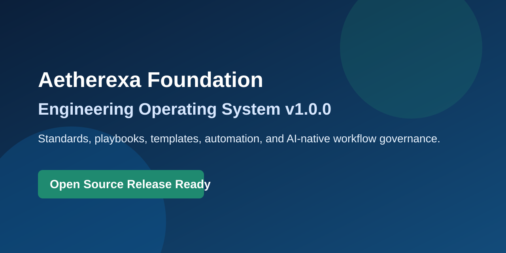

# Aetherexa Foundation Engineering Operating System

The official engineering operating system for all Aetherexa products.

This repository contains no product code. It defines how products are designed, built, reviewed, secured, released, and evolved.

## Mission

Create a durable, high-trust engineering system that enables teams to ship reliable software quickly without sacrificing quality, security, or maintainability.

## Why Foundation Exists

- Prevent process drift across products and teams.
- Encode institutional engineering knowledge into repeatable systems.
- Standardize architecture, quality, security, and release decisions.
- Enable AI-native collaboration with strong governance and review controls.

## Features

- End-to-end engineering lifecycle playbooks.
- Architecture, decision, and review governance.
- Security, quality, testing, and performance standards.
- AI workforce roles and AI-native implementation workflow.
- Reusable templates for PRDs, RFCs, ADRs, releases, postmortems, and more.
- GitHub automation baseline (CI, CodeQL, Dependabot, release workflow).

## Repository Structure

- .github/: collaboration and automation scaffolding
- ai/: AI-native workflow and workforce role profiles
- architecture/: architecture operating standards
- automation/: automation strategy and operating model
- docs/: handbook, glossary, FAQ, and global indexes
- engineering/: coding and delivery standards
- examples/: usage examples for teams adopting this system
- playbooks/: implementation playbooks across engineering workflows
- templates/: standardized document templates
- testing/: testing systems and policy guidance
- security/: security governance and operational standards
- quality/: quality gates and review checklists
- release/: release planning and readiness operating model

## Engineering Lifecycle

1. Define: PRD and user outcomes
2. Design: RFC and architecture review
3. Decide: ADR and decision log updates
4. Implement: smallest safe change set
5. Validate: tests, quality, security, performance, accessibility
6. Release: rollout, rollback, and release notes
7. Learn: incidents, retrospectives, metrics, and continuous improvement

## AI Workforce

- Workflow: [AI-Native Workflow](ai/ai-native-workflow.md)
- Role system: [AI Workforce Roles Index](ai/roles/README.md)
- Role profiles include mission, decision authority, review checklist, and anti-patterns.

## Quick Start

1. Read docs/company-handbook.md
2. Read docs/INDEX.md
3. Read principles/engineering-principles.md
4. Read engineering/standards.md
5. Use templates/ for all formal artifacts
6. Follow playbooks/ for delivery and operations execution

## Repository Map

- Documentation index: [docs/INDEX.md](docs/INDEX.md)
- Engineering standards: [engineering/standards.md](engineering/standards.md)
- Quality gates: [quality/gates-and-checklists.md](quality/gates-and-checklists.md)
- Security policy: [SECURITY.md](SECURITY.md)
- Contribution guide: [CONTRIBUTING.md](CONTRIBUTING.md)
- Changelog: [CHANGELOG.md](CHANGELOG.md)
- Roadmap: [ROADMAP.md](ROADMAP.md)
- Foundation manifest: [FOUNDATION_MANIFEST.yaml](FOUNDATION_MANIFEST.yaml)

## Documentation Index

- Handbook: [docs/company-handbook.md](docs/company-handbook.md)
- Glossary: [docs/glossary.md](docs/glossary.md)
- FAQ: [docs/faq.md](docs/faq.md)
- Playbooks: [playbooks/README.md](playbooks/README.md)
- Templates: [templates/README.md](templates/README.md)
- AI workflow: [ai/ai-native-workflow.md](ai/ai-native-workflow.md)

## Roadmap

See [ROADMAP.md](ROADMAP.md) for staged adoption and maturity plans.

## Contribution Guide

See [CONTRIBUTING.md](CONTRIBUTING.md) for contribution paths, required workflow, and definition of done.

## License

Released under the MIT License. See [LICENSE](LICENSE).

## Governance

- Owners: Engineering Leadership Council
- Steward: Platform Engineering
- Change policy: Significant changes require RFC and architecture review
- Review cycle: Monthly operational review and quarterly strategic update

## Public Release Readiness

- Release notes: [RELEASE_NOTES.md](RELEASE_NOTES.md)
- Security policy: [SECURITY.md](SECURITY.md)
- Open source standards: [CODE_OF_CONDUCT.md](CODE_OF_CONDUCT.md), [CONTRIBUTING.md](CONTRIBUTING.md), [LICENSE](LICENSE)
- GitHub settings checklist: [.github/REPOSITORY_SETTINGS.md](.github/REPOSITORY_SETTINGS.md)
